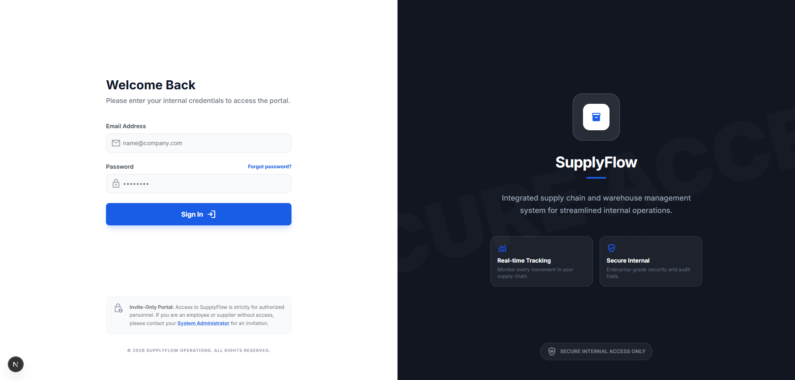
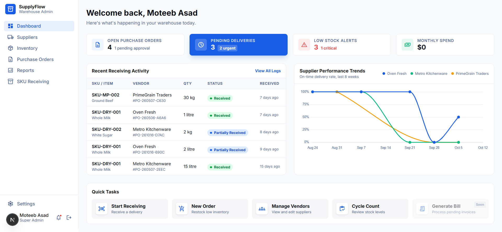
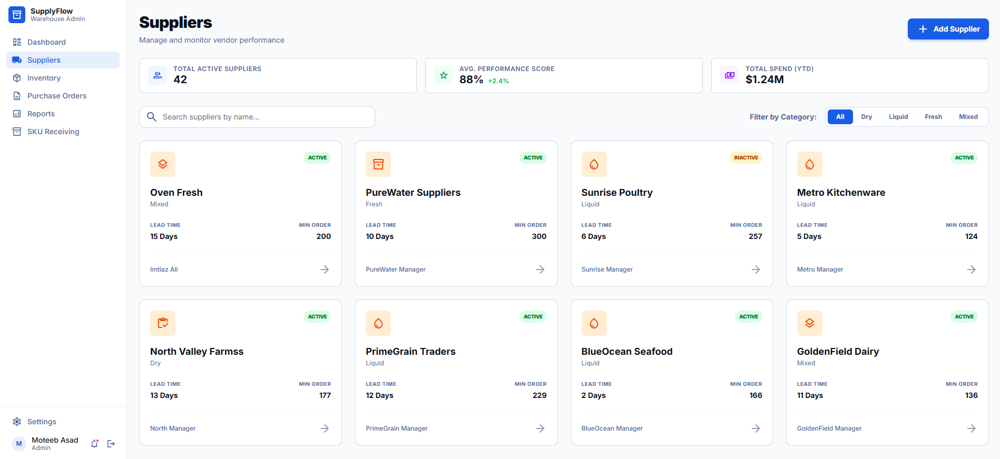
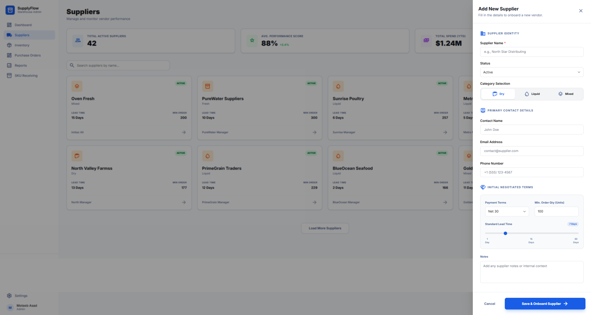
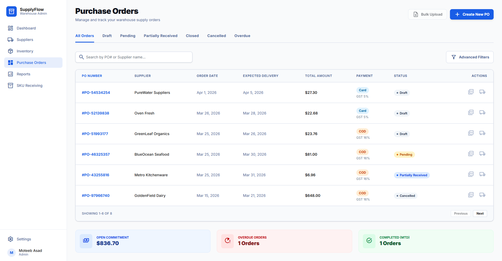
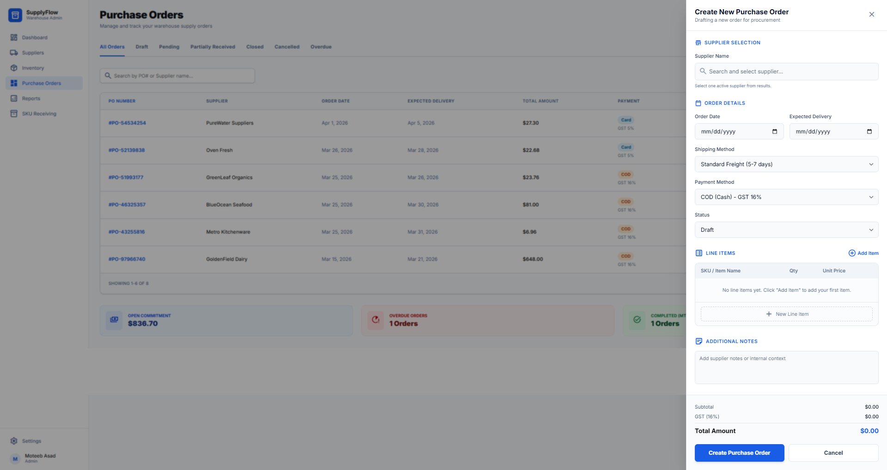

# SupplyFlow

## Overview

SupplyFlow is a B2B internal operations platform for supplier performance, inventory movement, and outlet stock operations.

It is designed to replace fragmented spreadsheets and manual follow-ups with a single role-aware workflow across purchasing, receiving, and stock tracking.

Core outcomes:

- Better visibility into inventory inflow and outflow.
- Better supplier decisions using performance trends.
- Better execution speed for warehouse and outlet teams.
- Better control through role-based access.

## Problem It Solves

Operations teams often manage suppliers, stock movement, and outlet requests across disconnected tools, which causes delays, errors, and poor visibility.

SupplyFlow solves this by providing:

- A single place to track suppliers, inventory, and orders.
- Clear role-based workflows for warehouse and operations users.
- Faster decision-making through structured data and operational insights.
- Better accountability with traceable actions and centralized records.

## Features

- Secure authentication with Supabase Auth.
- Role-based access control for `super_admin`, `operations_manager`, and `store_keeper`.
- Supplier management with on-time delivery tracking.
- Purchase order workflows: create, edit, detail view, and status tracking.
- SKU receiving against purchase orders, with accepted and rejected quantities per line.
- Inventory list with stock status (low and critical alerts).
- Live dashboard: KPI cards, recent receiving activity per SKU line, and a weekly supplier on-time delivery chart.
- Responsive UI with a shared layout and reusable table patterns.

### Screenshots

Result looks like:

<p align="left">
  
  
</p>

<p align="left">
  
  
</p>

<p align="left">
  
  
</p>

## Tech Stack

- Framework: Next.js 16.1.6 (App Router)
- React: 19.2.3
- Language: TypeScript (strict mode)
- Styling: Tailwind CSS v4
- Auth and database: Supabase (PostgreSQL)
- Data layer: Server actions + feature fetchers
- UI icons: Material Symbols Outlined

## Architecture

- App Router with server-first rendering.
- Route groups:
  - `(auth)` for login and password flows.
  - `(main)` for authenticated application routes.
- Nested layouts for persistent shell composition (sidebar/header).
- Feature-based organization under `src/features`.
- Reusable UI system under `src/components`.
- Shared permission and navigation logic under `src/lib`.
- Dashboard data comes from SQL functions that aggregate in the database, so the app receives only small result sets.

## Environment Variables

Create `.env.local` in the project root (or copy from `.env.example`):

```bash
NEXT_PUBLIC_SUPABASE_URL=your_supabase_project_url
NEXT_PUBLIC_SUPABASE_ANON_KEY=your_supabase_anon_key
NEXT_PUBLIC_SITE_URL=http://localhost:3000

SUPABASE_URL=your_supabase_project_url
SUPABASE_ANON_KEY=your_supabase_anon_key
SUPABASE_SERVICE_ROLE_KEY=your_service_role_key

ROOT_ADMIN_EMAIL=admin@example.com
ROOT_ADMIN_PASSWORD=your_secure_password
```

| Variable                        | Description                                     | Required |
| ------------------------------- | ----------------------------------------------- | -------- |
| `NEXT_PUBLIC_SUPABASE_URL`      | Supabase project URL (client + server usage)    | Yes      |
| `NEXT_PUBLIC_SUPABASE_ANON_KEY` | Supabase anonymous key                          | Yes      |
| `NEXT_PUBLIC_SITE_URL`          | Base URL used for auth and email redirects      | Yes      |
| `SUPABASE_URL`                  | Supabase project URL for scripts                | Optional |
| `SUPABASE_ANON_KEY`             | Supabase anon key for scripts                   | Optional |
| `SUPABASE_SERVICE_ROLE_KEY`     | Service role key for admin scripts              | Optional |
| `ROOT_ADMIN_EMAIL`              | Seed root admin email (used by setup script)    | Optional |
| `ROOT_ADMIN_PASSWORD`           | Seed root admin password (used by setup script) | Optional |

Notes:

- Do not commit real secrets in `.env` or `.env.local`.
- For production, set `NEXT_PUBLIC_SITE_URL` to your deployed domain.

## Authentication & Access Control

### User Roles

1. Super Admin (`super_admin`)

- Full system access.
- User management and invitations.

2. Operations Manager (`operations_manager`)

- Suppliers, inventory, and purchase orders.
- SKU receiving and reports.

3. Store Keeper (`store_keeper`)

- SKU receiving.
- Dashboard and own account settings.

### How RBAC Works

- Each user has exactly one role, stored in Supabase Auth `app_metadata.role`. Users cannot edit `app_metadata`, and database triggers keep it in sync with the roles table (migration 037).
- Permissions per role are defined in one place: `ROLE_PERMISSIONS` in `src/features/auth/constants/rbac.ts`. Use `hasPermission` and `hasAnyPermission` from `src/features/auth/utils/rbac.ts` to check them.
- Routes map to a permission in `src/lib/route-permissions.ts`.
- Middleware verifies the session with `supabase.auth.getClaims()` (local JWT verification), reads the role from the claims, and redirects users without the route's permission.
- The database enforces the same rules with RLS, so hidden UI is never the only protection.

### Route Permissions

| Route                            | Permission             | Roles                           |
| -------------------------------- | ---------------------- | ------------------------------- |
| `/dashboard`                     | `dashboard:view`       | All roles                       |
| `/sku-receiving`                 | `receiving:view`       | All roles                       |
| `/inventory`                     | `inventory:view`       | Super admin, operations manager |
| `/suppliers`                     | `suppliers:view`       | Super admin, operations manager |
| `/purchase-orders`               | `purchase_orders:view` | Super admin, operations manager |
| `/reports`                       | `reports:view`         | Super admin, operations manager |
| `/settings`, `/settings/account` | `settings:view`        | All roles                       |
| `/settings/user-management`      | `users:manage`         | Super admin                     |

## Getting Started

### Prerequisites

- Node.js 18+
- npm
- Supabase project

### Installation

1. Clone the repository.

```bash
git clone https://github.com/moteeb-asad/supply-flow.git
cd supply-flow
```

2. Install dependencies.

```bash
npm install
```

3. Configure environment variables.

```bash
NEXT_PUBLIC_SUPABASE_URL=your_project_url
NEXT_PUBLIC_SUPABASE_ANON_KEY=your_anon_key
```

4. Apply database migrations from `supabase/migrations/` in your Supabase project (see [Database Migrations](#database-migrations)).

5. Run development server.

```bash
npm run dev
```

App runs at `http://localhost:3000`.

### Build for Production

```bash
npm run build
npm start
```

## Database Migrations

- Run the files in `supabase/migrations/` in numeric order. Later migrations depend on earlier ones.
- Run `038_remove_roles_from_user_metadata.sql` only after the app version that reads roles from `app_metadata` is deployed. Running it earlier logs users out of their permissions.
- `supabase/schema-backup.sql` is a snapshot of the production schema, for reference only.

## Testing

- Linting: `npm run lint` (type-aware ESLint, zero warnings allowed)
- Type checking: `npm run typecheck` (`tsc --noEmit`, strict mode)
- Formatting: `npm run format` to fix, `npm run format:check` to verify (Prettier)
- CI: format check, lint, typecheck, knip, and build on pull requests to `develop` and `main`

## Roadmap

Short-term:

- Purchase order approvals and permission-based actions.
- Category management.
- Improve supplier insights and drill-down metrics.

Done:

- Purchase order create, edit, and detail workflows.
- SKU receiving against purchase orders.
- Live dashboard with supplier on-time delivery trends.

Mid-term:

- Outlet-level stock planning and forecasting.
- Alerting for delayed deliveries and low stock.
- Advanced reporting exports.

Long-term:

- Multi-warehouse orchestration.
- Barcode and scanner-assisted operations.
- Predictive replenishment and supplier recommendations.
